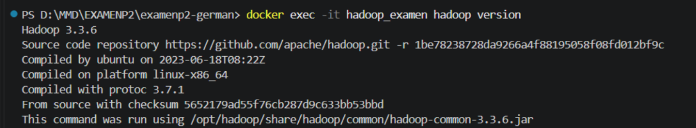
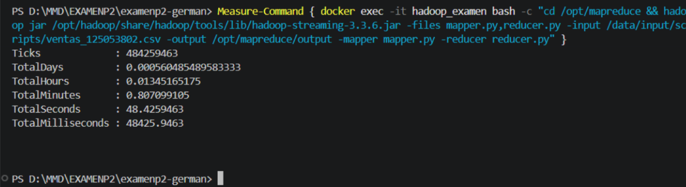
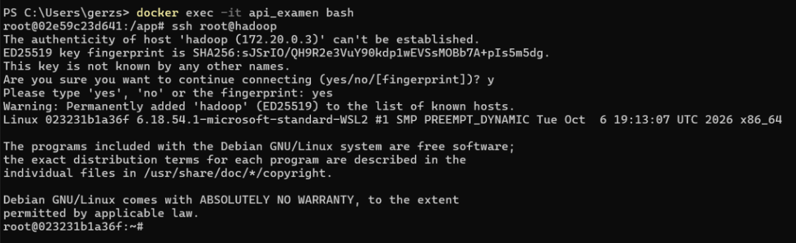
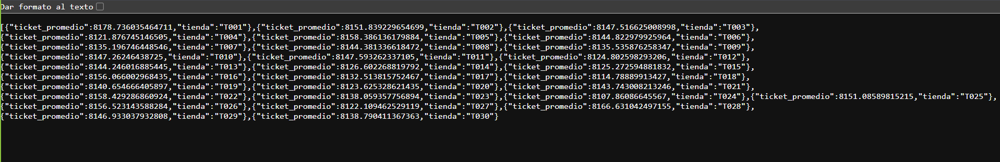

# Examen: Pipeline de Datos Contenerizado

Se planteó resolver una problematica para Datamart, basandonos en un problema especifico con base a nuestro ultimo digito de nuestra matricula. Sobre esto se trabajaría con Hadoop y Docker para realizar un Map Reduce y obtener los resultados esperados, así como comprobaciones con un archivo .py que pueda procesar el archivo directamente desde el host.

## Matricula: 125053802
## Pregunta asignada: 2. Ticket promedio (ingreso promedio por registro) por tienda.

Para este ejercicio, se busca obtener el ticket promedio de cada tienda en nuestros registros, para ello era necesario generar un dataset de registros, para posteriormente procesarlo y obtener los resultados, a continuación se muestra el paso a paso para realizar esta practica y obtener los resultados.

## Pasos para reproducir el proyecto

A continuación, se detalla el flujo de ejecución para levantar la infraestructura, procesar los datos y consumir la API:

**1. Levantar la infraestructura completa**
Construye y arranca los contenedores (Hadoop, PostgreSQL y API) en segundo plano, conectándolos en la misma red.
```bash
docker compose up -d --build
```

**2. Verificar la instalación de Hadoop**
Comprueba que Hadoop se instaló y configuró correctamente dentro de su contenedor.
```bash
docker exec -it hadoop_examen hadoop version
```

**3. Otorgar permisos a los scripts de MapReduce**
Se asignan permisos de ejecución a los archivos de Python (`mapper` y `reducer`) para evitar bloqueos durante el procesamiento.
```bash
docker exec -it hadoop_examen chmod +x /opt/mapreduce/mapper.py /opt/mapreduce/reducer.py
```

**4. Procesamiento masivo con Hadoop (MapReduce)**
Ejecuta el trabajo distribuido tomando el CSV de 5 millones de registros y calcula el ticket promedio por tienda. Al usar `Measure-Command`, se cronometra el tiempo total de la operación.
```powershell
Measure-Command { docker exec -it hadoop_examen bash -c "cd /opt/mapreduce && hadoop jar /opt/hadoop/share/hadoop/tools/lib/hadoop-streaming-3.3.6.jar -files mapper.py,reducer.py -input /data/input/scripts/ventas_125053802.csv -output /opt/mapreduce/output -mapper mapper.py -reducer reducer.py" }
```

**5. Comparativa de rendimiento (Script Secuencial)**
Ejecuta la misma lógica utilizando Pandas de forma local para comparar el tiempo de ejecución contra el clúster simulado de Hadoop.
```bash
python mapreduce/secuencial.py 
```

**6. Validación de comunicación SSH sin contraseña**
Demuestra que el contenedor de la API puede acceder al contenedor de Hadoop utilizando únicamente llaves generadas automáticamente.
```bash
# Entrar al contenedor de la API:
docker exec -it api_examen bash

# Conectarse a Hadoop internamente:
ssh root@hadoop
```

**7. Carga de resultados a PostgreSQL**
Lee el archivo de salida (`part-00000`) generado por Hadoop e inserta los tickets promedio limpios en la base de datos relacional.
```bash
docker exec -it api_examen python /data/input/scripts/cargar_resultados.py
```

**8. Consumo de la API (Lectura)**
Desde cualquier navegador web, ingresa a las siguientes rutas para validar los endpoints `GET`:
*   Ver todos los resultados: `http://localhost:5000/resultados`
*   Filtrar por una tienda específica (ej. T001): `http://localhost:5000/resultados/T001`

**9. Inyección de datos (Escritura / POST)**
Prueba el endpoint de escritura inyectando un registro simulado (Tienda T999) directamente desde PowerShell.
```powershell
Invoke-RestMethod -Uri http://localhost:5000/resultados -Method Post -Body '{"clave": "T999", "valor": 5555.55}' -ContentType "application/json"
```

**10. Validación de persistencia (Volúmenes)**
Apaga y destruye los contenedores, y luego vuelve a levantarlos. Al entrar de nuevo a la URL de la API, los datos seguirán intactos gracias al volumen externo configurado.
```bash
docker compose down
docker compose up -d
```

---

## Comparativa de Rendimiento

*   **Tiempo de ejecución con Hadoop (MapReduce):** 48.42 segundos.
*   **Tiempo de ejecución Secuencial (Pandas):**  6.68 segundos.

**Análisis de la comparativa:**
El script secuencial fue mucho más rápido que Hadoop MapReduce. Esto ocurre porque procesar un archivo de 400 MB en una sola máquina con RAM suficiente es muy eficiente. Hadoop, en cambio, pues tarda mas en preparar el entorno, iniciar procesos de Java, asignar tareas y coordinarse, y ese tiempo extra de preparación hace que MapReduce en un archivo de gran tamaño termine siendo más lento. MapReduce realmente conviene cuando procesas cientos de Gigabytes o Terabytes que simplemente ahogarían la memoria RAM de una sola máquina.

---
## Resultados Esperados


Al finalizar la ejecución del pipeline, el resultado devuelto por la API en la ruta /resultados será una lista en formato JSON que contiene el ticket promedio de compra calculado para cada una de las 30 tiendas (desde la clave T001 hasta la T030), procesadas a partir del dataset de 5 millones de registros.
Además de incluir nuestra inyección de una tienda T999.
---
## Evidencias Gráficas

**1. Versión de Hadoop**
Demostración de que el contenedor instaló correctamente el entorno de Java y la versión 3.3.6 de Hadoop solicitada.


**2. Salida del Job (MapReduce)**
Ejecución exitosa del script analítico procesando los 5 millones de registros y mostrando el tiempo total de procesamiento.


**3. Conexión SSH sin contraseña**
Comprobación de que el contenedor de la API logró autenticarse en el contenedor de Hadoop mediante volúmenes de llaves RSA, sin requerir intervención manual.


**4. Respuesta de la API**
Validación final de la integración: Los datos procesados por Hadoop y almacenados en PostgreSQL son expuestos exitosamente en formato JSON a través de Flask.


---

## TEORIA: Resolución de Preguntas:

**Explica la diferencia entre los modos standalone, pseudo-distribuido y totalmente distribuido de Hadoop. ¿En cuál de ellos se usa HDFS?**
El modo standalone corre en un solo proceso para pruebas locales rapidas (como hicimos nosotros). El pseudo-distribuido simula un clúster entero en una sola computadora, y el totalmente distribuido reparte el trabajo en varios servidores físicos reales. El sistema de archivos HDFS se usa solamente en el de pseudo-distribuido y en el totalmente distribuido. 

**¿Por qué el dataset se monta como volumen y no se copia dentro de la imagen con COPY? Menciona al menos dos razones.**
La primera razón es para no "inflar" nuestra imagen de Docker haciéndola pesar 400 MB extra sin necesidad. La segunda razón es por flexibilidad: el volumen nos permite modificar o cambiar el archivo CSV directamente desde nuestra computadora sin tener que volver a construir (build) todo el contenedor desde cero. 

**¿Qué ocurre con los datos de la base de datos al ejecutar docker compose down? ¿Y con docker compose down -v?**
Al ejecutar docker compose down, los contenedores se apagan y se destruyen, pero tu información sigue a salvo porque el volumen externo de la base de datos queda intacto. En cambio, si agregas -v, Docker destruye también los volúmenes, lo que borraría permanentemente toda la información que cargaste en PostgreSQL

**¿Por qué MapReduce no siempre es más rápido que un script secuencial con un archivo de 400 MB? ¿A partir de qué condiciones conviene?**
MapReduce Tarda mas en preparar el entorno y la práctica, que en procesar el archivo, y ese tiempo extra de preparación hace que MapReduce en un archivo muy pesado termine siendo mas lento que usar la libreria Pandas en un codigo secuencial. MapReduce combiene ya cuando usamos archivos de más de cientos de Gbs o Tbs.

**Diferencia entre CMD y ENTRYPOINT, y entre COPY y ADD.**
CMD es un comando que podemos escribir facilmente al arrancar el contenedor, y ENTRYPOINT fuerza al contenedor a correr como un ejecutable principal, define el proposito fijo del contenedor.

COPY nos sirve para pasar archivos de nuestra pc al contenedor, ADD Hace lo mismo pero además se pueden descargar URLs o descomprimir archivos automaticamente, sin embargo no se recomienda usar ADD para descargar contenido de URLs porque puede dejar cache, o hacer que docker haga validaciones del archivo constantemente, o puede suceder que ese archivo no se pueda eliminar completamente despues.
